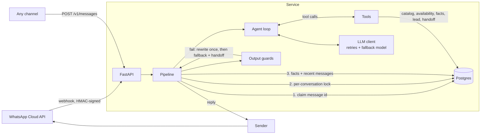

# whatsapp-agent-service

[](https://github.com/123idog/whatsapp-agent-service/actions/workflows/ci.yml)


**A reference implementation of a production WhatsApp AI agent, in Hebrew, Arabic and English: idempotent webhooks, durable customer memory, tool calling, output guards, human handoff, and evals in CI.**

Most agent demos show the happy path: a message comes in, the model answers. What breaks in production is everything around it:

- **The provider redelivers the same message**, and the customer gets two answers and two CRM records.
- **The customer sends three short messages in a row.** Three LLM calls race and the replies arrive out of order.
- **A deploy restarts the process** and the bot forgets who it was talking to.
- **The model answers an Arabic speaker in English**, leaks a tool name, or leaves a `{{name}}` in the text.
- **A person takes over the chat**, and the bot keeps talking over them.
- **The model provider has a bad hour**, and customers get silence.

This service handles each of those explicitly, and each has a test. The business is fictional (a bike rental and tours shop in Tel Aviv), and so is all the data.

```text
$ curl -s localhost:8000/v1/messages -d '{"message_id":"a1","conversation_id":"15550100009","text":"كم سعر الجولة مع مرشد؟"}'
{"status": "replied", "language": "arabic", "tool_calls": ["search_catalog"],
 "reply": "جولة مع مرشد على طول الشاطئ: 180 شيكل للشخص. ... لأي تاريخ؟"}

# same message id again (provider redelivery): same reply, no second LLM call
{"status": "duplicate", "reply": "جولة مع مرشد على طول الشاطئ: 180 شيكل للشخص. ..."}

$ ... -d '{"message_id":"a2", ..., "text":"ممكن احكي مع موظف؟"}'       # "can I talk to a person?"
{"status": "replied", "tool_calls": ["handoff_to_human"], "reply": "سأحولك إلى موظف، ..."}

$ ... -d '{"message_id":"a3", ..., "text":"مرحبا؟"}'
{"status": "human_active", "reply": null}       # a person owns the chat now; the bot stays quiet
```

---

## Architecture



One inbound message produces at most one reply:

1. **Claim the message id.** The `inbound_messages` primary key is the dedup. A redelivery gets the stored reply back.
2. **Lock the conversation.** A Postgres advisory lock, held for the whole turn, so it works across processes and machines.
3. **Human active?** Record the message and stay silent.
4. **Build the prompt from memory.** Structured facts ("name: Dana, group_size: 4") plus the last N messages, all from the database.
5. **Agent loop.** The model calls tools until it answers, bounded at 5 steps.
6. **Guards.** If the reply fails, the model gets one rewrite with the reasons. If that fails too, the customer gets a safe message and the conversation goes to a person.
7. **Record the turn.** Model, tokens, cost, latency, tools used and what the guards caught, one row per message.

---

## Production decisions

| Failure | What the code does | Where |
|---|---|---|
| Provider redelivers a message | Message id is a primary key; a duplicate returns the stored reply, no LLM call, no second lead | `store/*.claim_message`, `test_redelivered_message_is_answered_once` |
| Crash in the middle of a turn | The claim is released, so the provider's retry is processed instead of swallowed | `pipeline.handle`, `test_crash_releases_the_claim...` |
| Burst of messages from one customer | Per-conversation advisory lock; turn 2 sees turn 1's reply in its history | `PostgresStore.lock`, `test_same_conversation_is_serialised` |
| Restart wipes memory | Facts and transcript live in Postgres; CI restarts the container mid-conversation and checks | `store/schema.sql`, `ci.yml` docker job |
| Wrong language, English leak, `{{placeholder}}`, tool-name leak, mojibake, 3 questions in one message | Guards run before every send; one rewrite with the reasons, then fallback + handoff | `guards.py`, `test_bad_reply_is_rewritten_once` |
| Model invents a price | Prices only from `search_catalog`; scenario evals check for invented discounts and prices | `prompts/system.md`, `evals/scenarios.jsonl` |
| Person takes over | Conversation state `human`: the bot logs messages and stays silent until `/release` | `test_bot_stays_silent_while_a_human...` |
| Provider outage, 429s | Exponential backoff with jitter, honours `Retry-After`, no retry on 4xx, then a fallback model, then a polite handoff | `llm/openai_compat.py`, `test_llm_client.py` |
| Model loops on tools | Bounded at 5 steps per attempt, then fallback | `agent.py`, `test_tool_loop_is_bounded` |
| Bad tool arguments from the model | Tools return `{"error": ...}` instead of raising, so the model can recover | `tools.execute`, `test_bad_tool_input_never_raises` |
| Forged webhooks | HMAC-SHA256 signature check on the raw body | `channels.verify_signature` |
| Status callbacks (sent/read) | Ignored. A delivery receipt must never trigger a reply | `test_status_callbacks_are_ignored` |
| "What does a conversation cost?" | Tokens and USD per turn in the `turns` table and in the JSON logs | `pipeline._process` |

### Hebrew and Arabic specifics

- **Language follows the customer**, per message: an Arabic speaker who switches to English gets English. URLs and emails don't count as English.
- **Prefix-aware matching:** `לאופניים` matches `אופניים`, `بالدراجة` and `للعائلة` match `دراجة` and `عائلة`. Diacritics, tatweel and alef variants are normalised. This is a Python port of [hebrew-arabic-guards](https://github.com/123idog/hebrew-arabic-guards).
- **Names are cleaned before they are stored.** A WhatsApp profile name is often an emoji or a business name, so `save_customer_fact(name)` rejects `🔥🔥` and strips `דנה 🌸` to `דנה`.
- **The one-question rule counts both `?` and the Arabic `؟`.**

---

## Quick start

```bash
# Postgres + service, rule-based demo model, no API key needed
docker compose up --build
curl -s localhost:8000/v1/messages -H 'content-type: application/json' \
  -d '{"message_id":"m1","conversation_id":"15550100001","text":"כמה עולה סיור מודרך?"}'
curl -s localhost:8000/v1/conversations/15550100001     # facts, lead, messages, turns
```

With a real model, copy `.env.example` to `.env` and set `LLM_PROVIDER=openai_compat`, `LLM_API_KEY`, `LLM_MODEL`. The client speaks the OpenAI chat-completions format, so it works with OpenAI, Gemini (OpenAI-compatible endpoint), OpenRouter, Ollama or vLLM.

Without Docker:

```bash
pip install -e ".[dev]"            # add ,postgres for Postgres
uvicorn agent_service.main:app     # in-memory store when DATABASE_URL is empty
pytest
```

### Endpoints

| Method | Path | |
|---|---|---|
| `POST` | `/v1/messages` | Send a message, get the reply back (any channel) |
| `GET` | `/v1/conversations/{id}` | State, facts, lead, messages, turn records |
| `POST` | `/v1/conversations/{id}/release` | A person hands the chat back to the bot |
| `GET` / `POST` | `/webhooks/whatsapp` | WhatsApp Cloud API verification and inbound webhook |
| `GET` | `/healthz` | Liveness |

`/v1/*` requires `Authorization: Bearer $API_KEY` when `API_KEY` is set.

---

## Evals

Unit tests prove the plumbing. Scenario evals measure the model. `evals/scenarios.jsonl` holds multi-turn conversations with checks on the outcome, not just the text:

```json
{"id": "booking-flow-he", "turns": ["היי, אנחנו 4 אנשים ורוצים סיור מודרך לאורך החוף", "ביום חמישי, 4 ביוני", "קוראים לי דנה"],
 "expect": {"language": "hebrew", "lead": true, "facts_include": ["name"]}}
{"id": "saturday-closed-he", "turns": ["אפשר להזמין סיור מודרך לשבת הקרובה, 6.6?"],
 "expect": {"contains_any": ["שבת", "סגור", "סגורים"], "lead": false}}
```

Checks: reply language, required and forbidden content across every turn, tools called, whether a lead was created, whether facts were saved, whether the conversation was handed off, and whether it had to fall back. Each repeat is a fresh conversation through the real pipeline (store, tools, guards, handoff), with a fixed "today" so date logic is reproducible.

```bash
python evals/run_evals.py --repeats 3 --out runs/candidate.json    # real model
python evals/run_evals.py --demo --tag smoke --min-pass-rate 1.0   # what CI runs
```

What CI proves and what it doesn't:

- **On every push:** the `smoke` scenarios run against the rule-based demo model. That proves the harness and the pipeline work end to end. It does not measure model quality.
- **The full set:** the demo model passes 8 of 12. It fails the memory, Saturday, booking and refund scenarios. That gap is the point: the evals separate a weak model from a good one.
- **Real-model runs:** a manual `workflow_dispatch` job with an `LLM_API_KEY` secret. It writes the results JSON as a build artifact, which can be compared case by case with [llm-eval-kit](https://github.com/123idog/llm-eval-kit).

---

## Layout

```text
agent_service/
  app.py            FastAPI app, auth, WhatsApp webhook, JSON logging
  pipeline.py       one message in, at most one reply out
  agent.py          bounded tool-calling loop
  tools.py          tool schemas + implementations (never raise)
  guards.py         output guards
  text.py           script detection, normalisation, prefix-aware matching, name cleaning
  catalog.py        catalog + IDF-weighted keyword retrieval
  channels.py       WhatsApp Cloud API: signature, parsing, sender
  llm/              OpenAI-compatible client (retries, fallback), scripted + demo models
  store/            Store contract, in-memory and Postgres implementations, schema.sql
  prompts/system.md
evals/              scenarios + runner
tests/              61 tests; the store contract also runs against Postgres in CI
```

## Not in scope (yet)

- **A queue between the webhook and the agent.** The webhook acknowledges right away and processes in a background task, and dedup absorbs Meta's retries. If the process dies mid-turn after acknowledging, that message is lost. The fix is an outbox table with a worker. It is the next step, not something this repo claims to have.
- **Vector retrieval.** The catalog has 8 items, and IDF-weighted keyword matching is precise and explainable at that size. One known miss: "a tour for kids" ranks the coastal tour (ages 12+) above the family ride. The model sees the top 3 and the age rule, but at a few hundred items, embeddings are the right call.
- **Media messages** (voice, images) are ignored. Transcription and OCR would plug in before the pipeline.
- **The demo model is not an LLM.** It exists so `docker compose up` works without a key.

## Related

- [hebrew-arabic-guards](https://github.com/123idog/hebrew-arabic-guards): the JS library the guards are ported from
- [llm-eval-kit](https://github.com/123idog/llm-eval-kit): compare eval runs case by case, with flakiness and judge noise
- [llm-cost-report](https://github.com/123idog/llm-cost-report): cost per conversation and per result from traces

MIT
